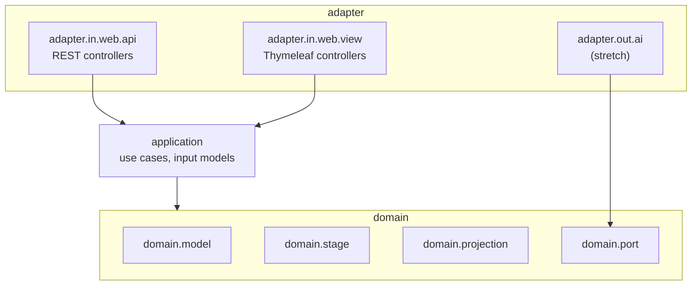

# Design: 001 — Project scaffold and package layout

<!-- Source: spec/001-project-scaffold-and-package-layout/requirements.md -->
<!-- Ticket: none (backlog story 001) -->
<!-- Date: 2026-09-13 -->

## 1. Architecture overview

A single Maven module producing one Spring Boot application. The scaffold creates the
ports-and-adapters package tree from PRD §8 with no behavior in it yet, plus the minimum
runtime needed to prove the build works: a main class, a health endpoint, and three tests.



Arrows are allowed dependency directions (enforced later by story 015). In this story every
package holds only a `package-info.java`.

### Repository layout after this story

```
rungs/
├── .editorconfig
├── .gitattributes
├── .gitignore                 (existing; kept)
├── .mvn/wrapper/maven-wrapper.properties
├── mvnw
├── mvnw.cmd
├── pom.xml
├── README.md
├── prd/ backlog/ spec/        (existing docs)
└── src/
    ├── main/
    │   ├── java/com/rungs/readiness/
    │   │   ├── RungsApplication.java
    │   │   ├── application/package-info.java
    │   │   ├── adapter/in/web/api/package-info.java
    │   │   ├── adapter/in/web/view/package-info.java
    │   │   ├── adapter/out/ai/package-info.java
    │   │   └── domain/{model,stage,projection,port}/package-info.java
    │   └── resources/
    │       ├── application.properties
    │       ├── templates/.gitkeep
    │       └── static/.gitkeep
    └── test/java/com/rungs/readiness/
        ├── RungsApplicationTests.java
        ├── ActuatorExposureTests.java
        └── NeutralVocabularyTests.java
```

## 2. Tech stack

| Concern | Choice | Version / note |
| --- | --- | --- |
| Language | Java | 25 (`java.version` property) |
| Framework | Spring Boot starter parent | 4.1.1 |
| Build | Maven via wrapper | Maven 3.9.16, wrapper type `only-script` (no wrapper jar committed) |
| Web | `spring-boot-starter-webmvc` | managed by parent |
| Templates | `spring-boot-starter-thymeleaf` | managed by parent |
| Operations | `spring-boot-starter-actuator` | managed by parent |
| Tests | `spring-boot-starter-webmvc-test`, `spring-boot-starter-actuator-test` | managed by parent; JUnit 5 |
| Build guard | `maven-enforcer-plugin` | 3.6.3, managed by parent |
| Local JDK | Homebrew OpenJDK 26 | installed as Homebrew Maven's dependency; `--release 25` keeps compilation on the Java 25 API, and CI (story 019) runs on JDK 25 |

The deprecated `spring-boot-starter-web` is not used.

## 3. Data model / schema changes

None. No database, no persistence, no domain types in this story (PRD NFR-1).

## 4. API design

The only HTTP surface is Actuator health:

| Method | Path | Response |
| --- | --- | --- |
| GET | `/actuator/health` | `200 {"status":"UP"}` |
| GET | `/actuator/env` (and every other Actuator endpoint) | `404` |

`application.properties`:

```properties
spring.application.name=rungs
management.endpoints.web.exposure.include=health
management.endpoint.health.show-details=never
management.endpoint.health.probes.enabled=false
```

No other properties (REQ-013). Probes are off because Boot 4.1.1 enables them by default
(`AvailabilityProbesAutoConfiguration`, `matchIfMissing = true`), and the root health
response then lists `"groups":["liveness","readiness"]` even with details hidden. Story 017
enables them and updates the health test.

## 5. Build design (`pom.xml`)

- Parent: `org.springframework.boot:spring-boot-starter-parent:4.1.1`.
- Coordinates: `com.rungs:rungs:0.1.0-SNAPSHOT`, packaging `jar`, name `rungs`.

  The project's own version uses `-SNAPSHOT` during development; the Enforcer bans
  SNAPSHOT *dependencies*, not the project version.
- Properties: `java.version=25`.
- Dependencies: the five starters in §2.
- Plugins:
  - `spring-boot-maven-plugin` (from the parent; layered jar enabled by default).
  - `maven-enforcer-plugin`, execution `enforce` bound to `validate`, rules:
    - `requireJavaVersion` `[25,)`, message "Rungs requires Java 25 or newer."
    - `requireMavenVersion` `[3.9.16,)`, message "Use ./mvnw so Maven 3.9.16 or newer is used."
    - `requireReleaseDeps`, message "SNAPSHOT dependencies are not allowed." Default
      settings: the rule checks dependencies and the parent, never the project's own
      version, so `0.1.0-SNAPSHOT` passes. Do not set `onlyWhenRelease=true`, which would
      skip the rule on every SNAPSHOT build.
    - `requirePluginVersions`, message "Every plugin version must be pinned.", so no plugin
      version floats.
- Plugin management: pin `maven-site-plugin` to `3.22.0`, the latest stable release (4.0.0
  is still a milestone). Boot's BOM does not manage it, and `requirePluginVersions` checks
  the `clean`, `deploy`, and `site` lifecycle plugins by default and rejects Maven's built-in
  versions. Boot already pins the clean and deploy plugins.
- Mockito as a test agent: `maven-dependency-plugin` runs the `properties` goal, which exposes
  `${org.mockito:mockito-core:jar}`, and `maven-surefire-plugin` sets
  `<argLine>-javaagent:${org.mockito:mockito-core:jar}</argLine>`. Without it the JDK warns
  that an agent was loaded dynamically, and future JDKs will block that. Because the pom now
  sets `argLine`, `-DargLine=...` on the command line is ignored; add extra JVM arguments in
  the pom instead. Story 019's JaCoCo agent must prepend `@{argLine}` to keep Mockito loaded.
- No other modules, no `<modules>` section, no frontend plugin.

Wrapper generation (one time, during implementation):

```bash
brew install maven          # only to generate the wrapper; also installs OpenJDK 26
mvn -N wrapper:wrapper -Dmaven=3.9.16 -Dtype=only-script
```

After this, everything runs through `./mvnw`.

## 6. Code design

### `RungsApplication`

```java
package com.rungs.readiness;

@SpringBootApplication
public class RungsApplication {
    public static void main(String[] args) {
        SpringApplication.run(RungsApplication.class, args);
    }
}
```

### `package-info.java` (one per package, one-line Javadoc)

| Package | Javadoc |
| --- | --- |
| `domain.model` | Immutable domain types: Money, the financial snapshot, and its parts. |
| `domain.stage` | Stage evaluators and the ladder that picks the current stage. |
| `domain.projection` | Debt payoff simulation and payoff ordering strategies. |
| `domain.port` | Interfaces the domain owns for outbound adapters. |
| `application` | Use-case services and validated input models shared by all inbound adapters. |
| `adapter.in.web.api` | REST controllers, request/response DTOs, and problem details. |
| `adapter.in.web.view` | Thymeleaf view controllers that call application services in-process. |
| `adapter.out.ai` | Outbound AI categorization client (stretch). |

### Tests

- `RungsApplicationTests`: `@SpringBootTest`, one `contextLoads()` test (REQ-009).
- `ActuatorExposureTests`: `@SpringBootTest` plus `@AutoConfigureMockMvc`
  (`org.springframework.boot.webmvc.test.autoconfigure`, from `spring-boot-webmvc-test`),
  asserting with an injected `MockMvcTester`:
  - `GET /actuator/health` → 200 and body exactly `{"status":"UP"}` (probes off, §4).
  - `GET /actuator/env` → 404.
  - `GET /actuator` → 200, and `_links` has exactly the keys `self`, `health`, and
    `health-path`. Boot adds one link per web operation, and the health operation with a
    path selector gets the ID `health-path`.
- `NeutralVocabularyTests` (REQ-015): plain JUnit 5 with no Spring context.
  - Walks the project root (Surefire's working directory, checked by asserting `pom.xml`
    exists) without following links. Skips `.git/`, `.idea/`, and `.vscode/` at any depth;
    skips `target/`, `prd/`, `backlog/`, and its own source file only at their root-relative
    paths, so a source package named `target` is still scanned. Hidden folders such as
    `.mvn/` are scanned.
  - Checks each file's root-relative path, reporting `path: file path contains a trademarked
    name`, so asset names are caught even for binary files.
  - Reads each file as UTF-8. Files that do not decode have their contents skipped; their
    path is still checked.
  - Matches over whole file contents, so a term wrapped across lines is still found; the
    reported line is the one where the match starts. Matches, ignoring case, the PRD §1
    terms (the first in singular or plural) and the trademark owner's name, with no word
    boundaries so identifiers that embed a term are caught.
  - Between words, accepts nothing or any mix of whitespace (line breaks, tabs, and, via
    `UNICODE_CHARACTER_CLASS`, non-breaking spaces), hyphens, underscores, dots, and the
    comment and quote markers `/`, `*`, `#`, `>` that start a wrapped line.
  - Fails with every `path:line: text` match listed.
  - A `@TempDir` test pins the walker: skip rules, the `path:line` format, a wrapped-line
    hit, a scanned `.mvn/` file, a scanned nested `target` package, a path-only hit, and the
    binary-file skip. Parameterized tests cover 30 spellings that must match and 6 neutral
    phrases that must not.
  - Spec documents are scanned, so they refer to the terms through PRD §1 and never spell
    them out, even split across lines.

In Boot 4, `@SpringBootTest` alone does not provide MockMvc; `@AutoConfigureMockMvc` is
required. `MockMvcTester` uses AssertJ, which `spring-boot-starter-test` already provides.

## 7. README design

Sections, in order:

1. **Rungs**: one-paragraph summary in neutral vocabulary (a stateless engine that
   assesses a household against a seven-stage debt-elimination and wealth-building
   framework and projects the payoff path).
2. **Nothing is stored**: the no-persistence, no-cookies, no-logging-of-figures claim.
3. **Prerequisites**: JDK 25 (any vendor). Nothing else.
4. **Build and run**: `./mvnw verify`, `./mvnw spring-boot:run`,
   `curl localhost:8080/actuator/health`.
5. **Deliberately not included**:
   - from PRD §12: authentication, rate limiting, persistence, multi-tenancy,
     internationalization;
   - from design spec §8: saved households, printing/PDF, dark mode, charting,
     save-in-place.
6. **Project documents**: links to `prd/`, `backlog/`, `spec/`.

No trademarked framework names anywhere (PRD §1).

## 8. Supporting files

- `.editorconfig` (REQ-014): UTF-8, LF, final newline, 4-space indent for Java/XML, 2-space
  for YAML/JSON/HTML/CSS, trim trailing whitespace except Markdown. A `[*.{cmd,bat}]` section
  sets `end_of_line = crlf` so saving `mvnw.cmd` in a compliant editor keeps Windows line
  endings.
- `.gitattributes` (Story 2, fresh clone with only a JDK): pins line endings in git so they
  don't depend on each machine's `core.autocrlf`:

  ```gitattributes
  * text=auto eol=lf
  /mvnw text eol=lf
  *.cmd text eol=crlf
  *.bat text eol=crlf
  ```

  Without it, Git for Windows (`core.autocrlf=true` by default) checks `mvnw` out with CRLF,
  and running it from WSL, Git Bash, or a Linux container fails with
  `/bin/sh^M: bad interpreter`. After adding the file, run `git add --renormalize` on the
  wrapper and supporting files and confirm with `git ls-files --eol` that `mvnw` is
  `i/lf w/lf` and `mvnw.cmd` is `i/lf w/crlf` (`text eol=crlf` stores LF in git and writes
  CRLF on checkout), and that `mvnw` is still mode `100755`.
- `.gitignore`: keep existing entries; add `.jqwik-database` now so story 014 needs no
  change.
- `templates/.gitkeep`, `static/.gitkeep` (REQ-007).

## 9. Security considerations

- Actuator exposes `health` only, with details hidden, so no environment, beans or
  configuration leak.
- No secrets or environment-specific values in properties; nothing to rotate.
- No database, session, or datasource starters, so there is no persistence path (NFR-1).
- The wrapper's `only-script` type downloads Maven from Maven Central over HTTPS, with no
  binary jar committed to the repo.
- Dependency versions come from the Boot BOM; the Enforcer blocks SNAPSHOT dependencies
  and unpinned plugins.

## 10. Performance considerations

- None beyond a normal Spring Boot startup; no endpoint budgets apply to this story.
- A reproducible build (pinned versions) keeps CI cache hits high later (story 019).

## 11. Deployment strategy

- Local only: `./mvnw spring-boot:run` on port 8080.
- No container, CI, or release in this story (stories 019, 037).
- Committed directly to `main`.

## 12. Implementation sequence

1. Install Maven via Homebrew, which brings OpenJDK 26 (user approves prompts).
2. Write `pom.xml`, generate the wrapper, and confirm `./mvnw -v` reports Maven 3.9.16 on
   the local JDK 26. Homebrew's OpenJDK is keg-only, so set `JAVA_HOME` to
   `/opt/homebrew/opt/openjdk/libexec/openjdk.jdk/Contents/Home` for `./mvnw`.
3. Add `RungsApplication`, `package-info.java` files, resources, and `application.properties`.
4. Add the three tests; run `./mvnw verify`.
5. Add README, `.editorconfig`, and the `.gitignore` update.
6. Manual checks: `./mvnw spring-boot:run` plus `curl` health; check that the Enforcer
   message appears when run with a JDK below 25 (if one is available), otherwise by
   temporarily raising the required version.

## 13. Risks and mitigations

| Risk | Impact | Mitigation |
| --- | --- | --- |
| Boot 4 test auto-configuration packages differ from Boot 3 examples | Test compile errors | Import `AutoConfigureMockMvc` from `org.springframework.boot.webmvc.test.autoconfigure` (checked against the 4.1.1 jars); no Boot 3 snippets copied |
| Boot 4 enables probes by default, adding `groups` to the health response | Exact-body assertion fails | `management.endpoint.health.probes.enabled=false` (§4); story 017 enables probes and updates the test |
| Discovery page lists `self` and `health-path` besides `health` | "Only health" assertion fails | Test pins the exact link set `self`, `health`, `health-path` (§6) |
| `requirePluginVersions` rejects the unpinned `maven-site-plugin` (not managed by Boot's BOM) | Build fails immediately | Pin `maven-site-plugin` 3.22.0 in `<pluginManagement>` (§5) |
| `requireReleaseDeps` misconfigured with `onlyWhenRelease=true` | Rule silently skips every SNAPSHOT build | Keep default settings; the rule checks dependencies and the parent, never the project's own version |
| Local JDK (26) is newer than the target (25) | Behavior seen only on JDK 25 is missed locally | `--release 25` blocks JDK 26-only APIs at compile time; CI on JDK 25 (story 019) catches runtime differences |
| Windows clone checks `mvnw` out with CRLF, or an editor saves `mvnw.cmd` as LF | `./mvnw` fails with "bad interpreter"; Windows wrapper breaks | `.gitattributes` pins `mvnw` to LF and `*.cmd` to CRLF; `.editorconfig` keeps `*.cmd` CRLF (§8) |
| Thymeleaf warns about an empty template location | Noisy startup log | `.gitkeep` keeps `templates/` on the classpath; warning checked on first run |
| Trademarked names slip into README, code, or file names | Public-repo exposure | `NeutralVocabularyTests` scans contents and paths, across wrapped lines and mixed separators, and fails `./mvnw verify` (REQ-015); no later story covers this |
| Vocabulary scan trips on local untracked files | False failures on one machine | Skip `.git/` and IDE folders at any depth and root `target/`; widen the skip list only for generated or untracked folders |
| Pom sets Surefire `argLine` for the Mockito agent | `-DargLine=...` is silently ignored; a later JaCoCo agent could drop Mockito's | Put extra JVM arguments in the pom; story 019 prepends `@{argLine}` (§5) |

## 14. Requirements traceability

| Requirement | Design section |
| --- | --- |
| REQ-001 single module, coordinates | §5 |
| REQ-002 Boot 4.1.1, Java 25 | §2, §5 |
| REQ-003 wrapper pinned | §2, §5 |
| REQ-004 main class | §6 |
| REQ-005 packages + package-info | §1, §6 |
| REQ-006 dependencies | §2 |
| REQ-007 templates/static tracked | §1, §8 |
| REQ-008 health only + test | §4, §6 |
| REQ-009 context test | §6 |
| REQ-010 README | §7 |
| REQ-011 no frontend toolchain | §5 |
| REQ-012 Enforcer | §5 |
| REQ-013 minimal properties | §4 |
| REQ-014 `.editorconfig` | §8 |
| REQ-015 trademark scan test | §6, §13 |
