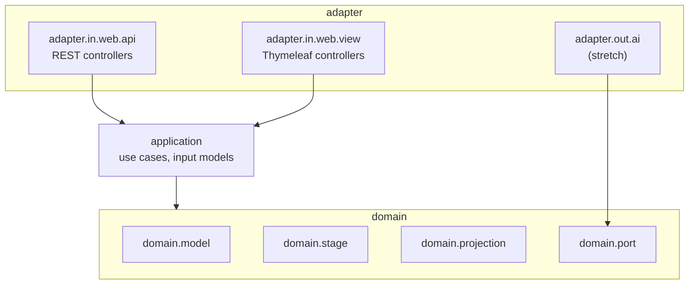

# Design: 001 — Project scaffold and package layout

<!-- Source: spec/001-project-scaffold-and-package-layout/requirements.md -->
<!-- Ticket: none (backlog story 001) -->
<!-- Date: 2026-09-13 -->

## 1. Architecture overview

A single Maven module producing one Spring Boot application. The scaffold creates the
ports-and-adapters package tree from PRD §8 with no behavior in it yet, plus the minimum
runtime needed to prove the build works: a main class, a health endpoint, and two tests.



Arrows are allowed dependency directions (enforced later by story 015). In this story every
package holds only a `package-info.java`.

### Repository layout after this story

```
rungs/
├── .editorconfig
├── .gitignore                 (existing; kept)
├── .mvn/wrapper/maven-wrapper.properties
├── mvnw
├── mvnw.cmd
├── pom.xml
├── README.md
├── prd/ backlog/ spec/        (existing docs)
└── src/
    ├── main/
    │   ├── java/com/rungs/readiness/
    │   │   ├── RungsApplication.java
    │   │   ├── application/package-info.java
    │   │   ├── adapter/in/web/api/package-info.java
    │   │   ├── adapter/in/web/view/package-info.java
    │   │   ├── adapter/out/ai/package-info.java
    │   │   └── domain/{model,stage,projection,port}/package-info.java
    │   └── resources/
    │       ├── application.properties
    │       ├── templates/.gitkeep
    │       └── static/.gitkeep
    └── test/java/com/rungs/readiness/
        ├── RungsApplicationTests.java
        └── ActuatorExposureTests.java
```

## 2. Tech stack

| Concern | Choice | Version / note |
| --- | --- | --- |
| Language | Java | 25 (`java.version` property) |
| Framework | Spring Boot starter parent | 4.1.1 |
| Build | Maven via wrapper | Maven 3.9.16, wrapper type `only-script` (no wrapper jar committed) |
| Web | `spring-boot-starter-webmvc` | managed by parent |
| Templates | `spring-boot-starter-thymeleaf` | managed by parent |
| Operations | `spring-boot-starter-actuator` | managed by parent |
| Tests | `spring-boot-starter-webmvc-test`, `spring-boot-starter-actuator-test` | managed by parent; JUnit 5 |
| Build guard | `maven-enforcer-plugin` | 3.6.3, managed by parent |
| Local JDK | Eclipse Temurin 25 | installed via `brew install --cask temurin@25` at implementation |

The deprecated `spring-boot-starter-web` is not used.

## 3. Data model / schema changes

None. No database, no persistence, no domain types in this story (PRD NFR-1).

## 4. API design

The only HTTP surface is Actuator health:

| Method | Path | Response |
| --- | --- | --- |
| GET | `/actuator/health` | `200 {"status":"UP"}` |
| GET | `/actuator/env` (and every other Actuator endpoint) | `404` |

`application.properties`:

```properties
spring.application.name=rungs
management.endpoints.web.exposure.include=health
management.endpoint.health.show-details=never
```

No other properties (REQ-013).

## 5. Build design (`pom.xml`)

- Parent: `org.springframework.boot:spring-boot-starter-parent:4.1.1`.
- Coordinates: `com.rungs:rungs:0.1.0-SNAPSHOT`, packaging `jar`, name `rungs`.

  The project's own version uses `-SNAPSHOT` during development; the Enforcer bans
  SNAPSHOT *dependencies*, not the project version.
- Properties: `java.version=25`.
- Dependencies: the five starters in §2.
- Plugins:
  - `spring-boot-maven-plugin` (from the parent; layered jar enabled by default).
  - `maven-enforcer-plugin`, execution `enforce` bound to `validate`, rules:
    - `requireJavaVersion` `[25,)`, message "Rungs requires Java 25 or newer."
    - `requireMavenVersion` `[3.9.16,)`, message "Use ./mvnw so Maven 3.9.16 or newer is used."
    - `requireReleaseDeps`, message "SNAPSHOT dependencies are not allowed."
    - `requirePluginVersions` so no plugin version floats.
- No other modules, no `<modules>` section, no frontend plugin.

Wrapper generation (one time, during implementation):

```bash
brew install maven          # temporary, only to generate the wrapper
mvn -N wrapper:wrapper -Dmaven=3.9.16 -Dtype=only-script
```

After this, everything runs through `./mvnw`.

## 6. Code design

### `RungsApplication`

```java
package com.rungs.readiness;

@SpringBootApplication
public class RungsApplication {
    public static void main(String[] args) {
        SpringApplication.run(RungsApplication.class, args);
    }
}
```

### `package-info.java` (one per package, one-line Javadoc)

| Package | Javadoc |
| --- | --- |
| `domain.model` | Immutable domain types: Money, the financial snapshot, and its parts. |
| `domain.stage` | Stage evaluators and the ladder that picks the current stage. |
| `domain.projection` | Debt payoff simulation and payoff ordering strategies. |
| `domain.port` | Interfaces the domain owns for outbound adapters. |
| `application` | Use-case services and validated input models shared by all inbound adapters. |
| `adapter.in.web.api` | REST controllers, request/response DTOs, and problem details. |
| `adapter.in.web.view` | Thymeleaf view controllers that call application services in-process. |
| `adapter.out.ai` | Outbound AI categorization client (stretch). |

### Tests

- `RungsApplicationTests`: `@SpringBootTest`, one `contextLoads()` test (REQ-009).
- `ActuatorExposureTests`: `@SpringBootTest` with MockMvc auto-configuration:
  - `GET /actuator/health` → 200 and body exactly `{"status":"UP"}`.
  - `GET /actuator/env` → 404.
  - `GET /actuator` → the discovery page lists only `health` (or 404 if discovery is
    disabled). Pinned during implementation.

Boot 4 moved the MockMvc test auto-configuration into the `webmvc-test` module; the import
path is confirmed at implementation.

## 7. README design

Sections, in order:

1. **Rungs**: one-paragraph summary in neutral vocabulary (a stateless engine that
   assesses a household against a seven-stage debt-elimination and wealth-building
   framework and projects the payoff path).
2. **Nothing is stored**: the no-persistence, no-cookies, no-logging-of-figures claim.
3. **Prerequisites**: JDK 25 (any vendor). Nothing else.
4. **Build and run**: `./mvnw verify`, `./mvnw spring-boot:run`,
   `curl localhost:8080/actuator/health`.
5. **Deliberately not included**:
   - from PRD §12: authentication, rate limiting, persistence, multi-tenancy,
     internationalization;
   - from design spec §8: saved households, printing/PDF, dark mode, charting,
     save-in-place.
6. **Project documents**: links to `prd/`, `backlog/`, `spec/`.

No trademarked framework names anywhere (PRD §1).

## 8. Supporting files

- `.editorconfig` (REQ-014): UTF-8, LF, final newline, 4-space indent for Java/XML, 2-space
  for YAML/JSON/HTML/CSS, trim trailing whitespace except Markdown.
- `.gitignore`: keep existing entries; add `.jqwik-database` now so story 014 needs no
  change.
- `templates/.gitkeep`, `static/.gitkeep` (REQ-007).

## 9. Security considerations

- Actuator exposes `health` only, with details hidden, so no environment, beans or
  configuration leak.
- No secrets or environment-specific values in properties; nothing to rotate.
- No database, session, or datasource starters, so there is no persistence path (NFR-1).
- The wrapper's `only-script` type downloads Maven from Maven Central over HTTPS, with no
  binary jar committed to the repo.
- Dependency versions come from the Boot BOM; the Enforcer blocks SNAPSHOT dependencies
  and unpinned plugins.

## 10. Performance considerations

- None beyond a normal Spring Boot startup; no endpoint budgets apply to this story.
- A reproducible build (pinned versions) keeps CI cache hits high later (story 019).

## 11. Deployment strategy

- Local only: `./mvnw spring-boot:run` on port 8080.
- No container, CI, or release in this story (stories 019, 037).
- Committed directly to `main`.

## 12. Implementation sequence

1. Install JDK 25 and temporary Maven via Homebrew (user approves prompts).
2. Write `pom.xml`, generate the wrapper, and confirm `./mvnw -v` reports Maven 3.9.16 on
   Java 25.
3. Add `RungsApplication`, `package-info.java` files, resources, and `application.properties`.
4. Add the two tests; run `./mvnw verify`.
5. Add README, `.editorconfig`, and the `.gitignore` update.
6. Manual checks: `./mvnw spring-boot:run` plus `curl` health; check that the Enforcer
   message appears when run with a JDK below 25 (if one is available), otherwise by
   temporarily raising the required version.

## 13. Risks and mitigations

| Risk | Impact | Mitigation |
| --- | --- | --- |
| Boot 4 test auto-configuration packages differ from Boot 3 examples | Test compile errors | Resolve imports against the 4.1.1 jars during implementation; no Boot 3 snippets copied blindly |
| Health response includes extra keys (e.g. `groups`) if probes auto-enable | Exact-body assertion fails | Probes are not enabled in this story; the test pins the exact body and story 017 updates it deliberately |
| `requireReleaseDeps` flags the project's own `-SNAPSHOT` version | Build fails immediately | Configure the rule to check dependencies only (`onlyWhenRelease=false`, exclude the project itself); verify on first run |
| No JDK/Maven on the machine | Cannot build | Homebrew installs at step 1 |
| Thymeleaf warns about an empty template location | Noisy startup log | `.gitkeep` keeps `templates/` on the classpath; warning checked on first run |
| Trademarked names slip into README or code | Public-repo exposure | Manual search before committing (story 015 automates later checks) |

## 14. Requirements traceability

| Requirement | Design section |
| --- | --- |
| REQ-001 single module, coordinates | §5 |
| REQ-002 Boot 4.1.1, Java 25 | §2, §5 |
| REQ-003 wrapper pinned | §2, §5 |
| REQ-004 main class | §6 |
| REQ-005 packages + package-info | §1, §6 |
| REQ-006 dependencies | §2 |
| REQ-007 templates/static tracked | §1, §8 |
| REQ-008 health only + test | §4, §6 |
| REQ-009 context test | §6 |
| REQ-010 README | §7 |
| REQ-011 no frontend toolchain | §5 |
| REQ-012 Enforcer | §5 |
| REQ-013 minimal properties | §4 |
| REQ-014 `.editorconfig` | §8 |
