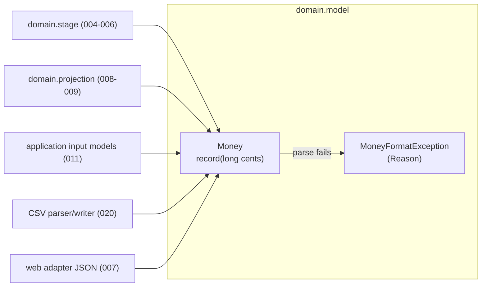

# Design: 002 — Money value type

<!-- Source: spec/002-money-value-type/requirements.md -->
<!-- Ticket: none (backlog story 002) -->
<!-- Date: 2026-09-13 -->

## 1. Architecture overview

`Money` is a pure domain value in `com.rungs.readiness.domain.model`: a Java record over a
single `long cents`, plus one companion exception. It has no dependencies beyond
`java.base`, so the domain stays framework-free (PRD AC-A) and every later layer can use it.



Four concerns live in the type, each kept separate in the code:

| Concern | Members | Allocates? |
| --- | --- | --- |
| Exact arithmetic | `plus`, `minus`, `negate`, `compareTo`, `min`, `max`, `is*`, `sum` | No |
| Scaled arithmetic | `times(BigDecimal)` | Yes (`BigDecimal`) |
| Formatting | `toDisplayString`, `toBareString` | Yes (`String`) |
| Parsing | `parse(String)` | Yes (`String` work) |

### Files after this story

```
src/main/java/com/rungs/readiness/domain/model/
├── Money.java
└── MoneyFormatException.java
src/test/java/com/rungs/readiness/domain/model/
├── MoneyArithmeticTests.java
├── MoneyFormattingTests.java
└── MoneyParsingTests.java
```

## 2. Tech stack

| Concern | Choice | Note |
| --- | --- | --- |
| Language | Java 25 record | Immutable by construction (AC-E) |
| Scaled math | `java.math.BigDecimal`, `RoundingMode.HALF_EVEN` | Only inside `times` |
| Tests | JUnit 5 (`@ParameterizedTest`, `@MethodSource`), AssertJ | Already on the test classpath |
| Coverage check | JaCoCo, run on demand from the command line | Not added to the pom; the gate arrives in story 019 |

No new dependencies. jqwik property tests come in story 014.

## 3. Data model

```java
public record Money(long cents) implements Comparable<Money>
```

- The canonical constructor accepts every `long`; there is no invalid `Money`. Rules such as
  "a balance cannot be negative" belong to validation (story 011).
- `equals`, `hashCode` compare `cents`, so `compareTo` is consistent with `equals`.
- No currency field (PRD NG5).
- `toString` stays the record default for now. Story 018 (REQ-003) replaces it with a
  redacted form; this story does not pre-empt that decision.

## 4. API design

### `Money`

| Member | Behavior | Errors |
| --- | --- | --- |
| `static final Money ZERO` | `new Money(0)` | — |
| `static Money ofCents(long cents)` | Wraps `cents` | — |
| `static Money ofDollars(long dollars)` | `Math.multiplyExact(dollars, 100)` (REQ-013) | `ArithmeticException` on overflow |
| `Money plus(Money other)` | `Math.addExact` | `ArithmeticException`; NPE if `other` is null |
| `Money minus(Money other)` | `Math.subtractExact` | as above |
| `Money negate()` | `Math.negateExact` | `ArithmeticException` for `Long.MIN_VALUE` |
| `Money times(BigDecimal factor)` | Exact product, rounded `HALF_EVEN` to the cent (§6.2) | `ArithmeticException` if it doesn't fit a `long`; NPE if null |
| `int compareTo(Money other)` | `Long.compare` | NPE if null |
| `Money min(Money other)` / `max(Money other)` | Smaller / larger; `this` on a tie | NPE if null |
| `boolean isZero()` / `isNegative()` / `isPositive()` | Sign tests on `cents` | — |
| `static Money sum(Collection<Money> amounts)` | Exact total; `ZERO` when empty (REQ-011) | `ArithmeticException`; NPE for a null collection or element |
| `String toDisplayString()` | `$1,234.56`, `-$1,234.56`, `$0.00` (REQ-005) | — |
| `String toBareString()` | `1234.56`, `-1234.56`, `0.00` (REQ-006) | — |
| `static Money parse(String text)` | Tolerant parse (§6.4) | `MoneyFormatException` |

`min` and `max` are instance methods, in the style of `BigDecimal`. No later spec calls
them statically.

### `MoneyFormatException`

```java
public final class MoneyFormatException extends IllegalArgumentException {
    public enum Reason { BLANK, TOO_LONG, INVALID_CHARACTER, MISSING_DIGITS,
                         MISPLACED_SEPARATOR, TOO_MANY_DECIMALS, OUT_OF_RANGE }
    public Reason reason();
}
```

- Unchecked, and a subtype of `IllegalArgumentException`, so story 011's handler can treat
  it as bad input without knowing about `Money`.
- The message is a fixed sentence per reason (for example "Amount has more than two decimal
  places."). It never contains the input (REQ-008, PRD NFR-2).

| Reason | Example inputs |
| --- | --- |
| `BLANK` | `null`, `""`, `"   "` |
| `TOO_LONG` | any input over 32 characters, before trimming (REQ-012) |
| `INVALID_CHARACTER` | `"12a"`, `"€5"`, `"$-5"`, `"1.2.3"`, `"١٢"` (non-ASCII digits) |
| `MISSING_DIGITS` | `"$"`, `"-"`, `".50"`, `"5."` |
| `MISPLACED_SEPARATOR` | `"1234,567"`, `"1,23"`, `",123"`, `"1,234,"`, `"1.2,3"` |
| `TOO_MANY_DECIMALS` | `"12.345"` |
| `OUT_OF_RANGE` | `"92233720368547758.08"` (one cent above `Long.MAX_VALUE`) |

`null` is reported as `BLANK` rather than a `NullPointerException`: the input models call
`parse` on form fields that may be absent, and one failure type is simpler for them.

### JSON wire contract (REQ-009, implemented elsewhere)

`Money` only supplies the two strings. Story 007's Jackson mapping writes
`{"amount": toBareString(), "display": toDisplayString()}` in responses and reads requests
with `parse`. Nothing in this story imports Jackson.

## 5. Build change (`pom.xml`)

The Surefire `argLine` from story 001 is a fixed value, so JaCoCo's `prepare-agent`
(which sets the `argLine` property) would be ignored and coverage could not be measured.
Change it to the late-replacement form and give the property an empty default:

```xml
<properties>
    <java.version>25</java.version>
    <argLine></argLine>
</properties>
...
<argLine>@{argLine} -javaagent:${org.mockito:mockito-core:jar}</argLine>
```

Coverage for the 100% success metric is then checked on demand, with no JaCoCo plugin in
the pom:

```bash
./mvnw org.jacoco:jacoco-maven-plugin:<version>:prepare-agent test \
       org.jacoco:jacoco-maven-plugin:<version>:report
```

Use the latest JaCoCo release that supports Java 25 class files and runs on the local
JDK 26. Story 019 turns this into a pom-managed gate.

## 6. Code design

### 6.1 Exact arithmetic

Each operation is one `Math.*Exact` call on `cents` and a new record. No `BigDecimal`, no
boxing (requirements: Performance). `sum` loops with `Math.addExact` over the collection.

### 6.2 `times(BigDecimal factor)`

```text
product = BigDecimal.valueOf(cents).multiply(factor)      // exact, no MathContext
if product.signum() == 0                → ZERO
e = product.precision() - product.scale() - 1             // decimal exponent of the leading digit
if e < -1                               → ZERO            // |product| < 0.1 cent, rounds to 0
if e > 18                               → ArithmeticException("Money overflow")
return ofCents(product.setScale(0, HALF_EVEN).longValueExact())
```

- The two guards keep `setScale` cheap. A factor with an extreme exponent (for example
  `1E-999999999` or `1E+999999999`) would otherwise force a huge power-of-ten division or
  expansion.
- `longValueExact` still throws `ArithmeticException` for results between 10^18 and the
  `long` limit that do not fit.
- Story 008 passes `annualInterestRate ÷ 1200` computed with `MathContext.DECIMAL128`; the
  single half-even rounding happens here.

### 6.3 Formatting

Both formats derive from `Long.toString(cents)`, so they never read the default locale and
`Long.MIN_VALUE` needs no special case (no `Math.abs`):

```text
s        = Long.toString(cents)
negative = s starts with "-"          // cents == 0 is never negative
digits   = s without "-", left-padded with "0" to at least 3 characters
whole    = digits minus its last 2 characters
fraction = last 2 characters
bare     = (negative ? "-" : "") + whole + "." + fraction
display  = (negative ? "-" : "") + "$" + group(whole, ',') + "." + fraction
```

`group` inserts a comma every three digits from the right, using a `StringBuilder`.

### 6.4 Parsing

A single left-to-right scan rather than a regular expression, so each failure maps to a
specific reason and the work is linear in an input capped at 32 characters.

```text
1. null                                   → BLANK
2. raw length > 32                        → TOO_LONG
3. s = text.strip(); empty                → BLANK
4. optional "-" then optional "$"         (only in that order)
5. remainder: every char must be ASCII 0-9, "," or "."; at most one "."
                                          → otherwise INVALID_CHARACTER
6. split at "." into whole and fraction
7. whole empty or starts with ","        → MISSING_DIGITS if empty, else MISPLACED_SEPARATOR
   whole contains ",": first group 1-3 digits, every later group exactly 3
                                          → otherwise MISPLACED_SEPARATOR
8. "." present: fraction contains ","    → MISPLACED_SEPARATOR
                fraction length 0         → MISSING_DIGITS
                fraction length > 2       → TOO_MANY_DECIMALS
9. accumulate whole digits then fraction (padded to 2) as a negative long with
   multiplyExact/subtractExact; if not negative, negateExact
                                          → ArithmeticException becomes OUT_OF_RANGE
```

- Accumulating on the negative side lets `-92233720368547758.08` parse to `Long.MIN_VALUE`,
  so `parse(toBareString(m))` holds for every `long`, not only down to `MIN_VALUE + 1`.
- `-0`, `-$0.00` parse to `ZERO` naturally, because `long` has no negative zero (REQ-007).
- Leading zeros (`007`) are accepted; `toBareString` writes the canonical form back.
- `strip()` removes Unicode whitespace, so a non-breaking space pasted from a spreadsheet is
  tolerated at the ends but rejected inside the number.
- No `double`, `float`, `Double.parseDouble`, or `new BigDecimal(String)` is used.

## 7. Tests

All example-based (property tests arrive in story 014). Test classes end in `Tests` to match
Surefire's default includes and the project's naming.

### `MoneyArithmeticTests`

- `ZERO`, `ofCents`, `ofDollars` (including overflow).
- `plus`/`minus`/`negate` for zero, ±1 cent, mixed signs; overflow at `Long.MAX_VALUE + 1`,
  `Long.MIN_VALUE - 1`, and `negate(Long.MIN_VALUE)`.
- `times` half-even rounding: cents × factor landing exactly on `.5` for `.005`, `.015`,
  `.025` and their negatives (hand-computed: 0, 2, 2 and 0, -2, -2 cents), plus `.0051`
  rounding up; factor zero, negative factor, extreme-exponent factors (returns `ZERO` or
  throws quickly), and a product just past `Long.MAX_VALUE`.
- `compareTo`, `min`/`max` including ties (returns `this`), `isZero`/`isNegative`/
  `isPositive` for -1, 0, 1.
- `sum` of empty, single, mixed, and overflowing collections.

### `MoneyFormattingTests`

- Display and bare output for 0, 1, 10, 99, 100, 123456, 100000000, -1, -123456,
  `Long.MAX_VALUE`, `Long.MIN_VALUE`.
- The same expectations re-run with `Locale.setDefault` set to `de-DE` and `fr-FR`
  (restored in `finally`), proving no locale dependence (Story 2).
- Zero never renders with a minus sign.

### `MoneyParsingTests`

- Accepted inputs from the requirements (`1234`, `1234.5`, `$1,234.56`, `-$50`, surrounding
  whitespace, `-0`, `-$0.00`, leading zeros) with expected cents.
- One or more rejected inputs per `Reason`, asserting the reason code and that the message
  does not contain the input.
- Exactly 32 characters accepted (when otherwise valid), 33 rejected as `TOO_LONG`.
- Round trip `parse(m.toBareString())` equals `m` for 0, ±1, ±50, ±123456,
  `Long.MAX_VALUE`, `Long.MIN_VALUE`, `Long.MIN_VALUE + 1`; also `parse(m.toDisplayString())`.

### Checks outside the test run

- A search of `Money.java`, `MoneyFormatException.java`, and the three test classes for
  `double`, `float`, `Double`, and `Float` finds nothing (REQ-010). Story 015's ArchUnit rule
  later enforces this for all of `domain`.
- JaCoCo report (§5) shows 100% line and branch coverage for both classes.
- `NeutralVocabularyTests` keeps passing.

## 8. Security considerations

- Exception messages never echo input, so a logged parse failure cannot leak a household
  figure (PRD NFR-2).
- Input is capped at 32 characters before any scanning; the parser is a single linear pass
  with no regular expressions, so there is no catastrophic backtracking.
- `times` guards against extreme `BigDecimal` exponents that could otherwise cost large
  amounts of CPU and memory.
- Overflow always throws, so no computation silently wraps to a wrong figure.
- The default record `toString` still prints `cents`. That is acceptable until story 018,
  because nothing logs domain objects yet; story 018 must redact it.

## 9. Performance considerations

- `plus`, `minus`, `negate`, comparisons, `min`/`max`, and `sum` are primitive `long`
  operations plus one small record allocation, which escape analysis usually removes in hot
  loops. This meets the requirement for 600-month, 50-debt projections.
- `times` allocates `BigDecimal`s; it runs once per debt per month in story 008.
- Formatting and parsing allocate strings and are called only at the edges (API, CSV).

## 10. Deployment strategy

- Library code only: no endpoint, configuration, or runtime change.
- Committed directly to `main`; `./mvnw verify` must pass.

## 11. Implementation sequence

1. `pom.xml`: `@{argLine}` late replacement with an empty default (§5); `./mvnw verify` still
   green with no warnings.
2. `MoneyFormatException` with `Reason` and fixed messages.
3. `Money` arithmetic, `times`, comparison, `sum`, factories, with `MoneyArithmeticTests`.
4. Formatting with `MoneyFormattingTests`.
5. Parsing with `MoneyParsingTests`, including round trips.
6. Floating-point search, JaCoCo 100% check, `./mvnw verify`.

## 12. Risks and mitigations

| Risk | Impact | Mitigation |
| --- | --- | --- |
| `Long.MIN_VALUE` breaks formatting or round trip via `Math.abs` | Wrong output or exception for one extreme value | Format from `Long.toString`; parse on the negative side; tests include `MIN_VALUE` |
| Extreme `BigDecimal` exponent in `times` | CPU/memory spike | Exponent guards before `setScale` (§6.2) with tests |
| Locale-dependent formatting slips in (e.g. `String.format`, `NumberFormat`) | Output differs by machine (NFR-4) | Manual digit grouping; tests under `de-DE` and `fr-FR` |
| Non-ASCII digits accepted via `Character.isDigit` | Surprising parses | Compare to `'0'`..`'9'` only; test with Arabic-Indic digits |
| `@{argLine}` change breaks the Mockito agent | Dynamic-agent warning returns | Verify `./mvnw verify` output has no warning after the change |
| JaCoCo version lacks Java 25/26 support | Coverage cannot be measured | Pick the newest release; if unsupported, record the gap and defer the measurement to story 019 |
| Default `toString` leaks amounts into logs | Figures in logs | Nothing logs domain types yet; story 018 REQ-003 redacts it |
| Parse messages too vague to act on | Poor error messages in story 011 | One fixed, specific sentence per `Reason`; story 011 maps reasons to field errors |

## 13. Requirements traceability

| Requirement | Design section |
| --- | --- |
| REQ-001 record, `ZERO`, `ofCents` | §3, §4 |
| REQ-002 exact `plus`/`minus`/`negate` | §4, §6.1 |
| REQ-003 `times` half-even | §4, §6.2 |
| REQ-004 `Comparable`, `min`/`max`, sign tests | §4 |
| REQ-005 display format | §4, §6.3 |
| REQ-006 bare format | §4, §6.3 |
| REQ-007 parse rules, negative zero | §4, §6.4 |
| REQ-008 `MoneyFormatException` with reason | §4 |
| REQ-009 wire contract strings | §4 |
| REQ-010 no floating point | §6.4, §7 |
| REQ-011 `sum` | §4, §6.1 |
| REQ-012 32-character bound | §4, §6.4, §8 |
| REQ-013 `ofDollars` | §4 |
